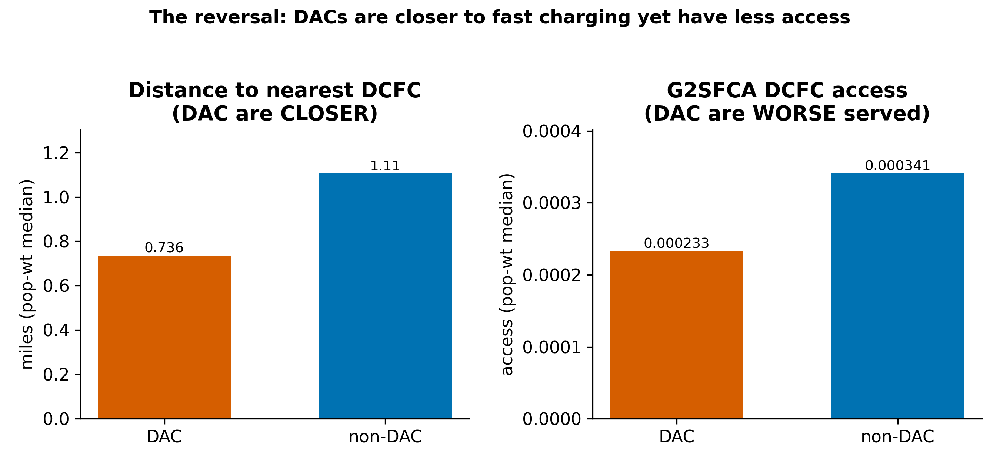
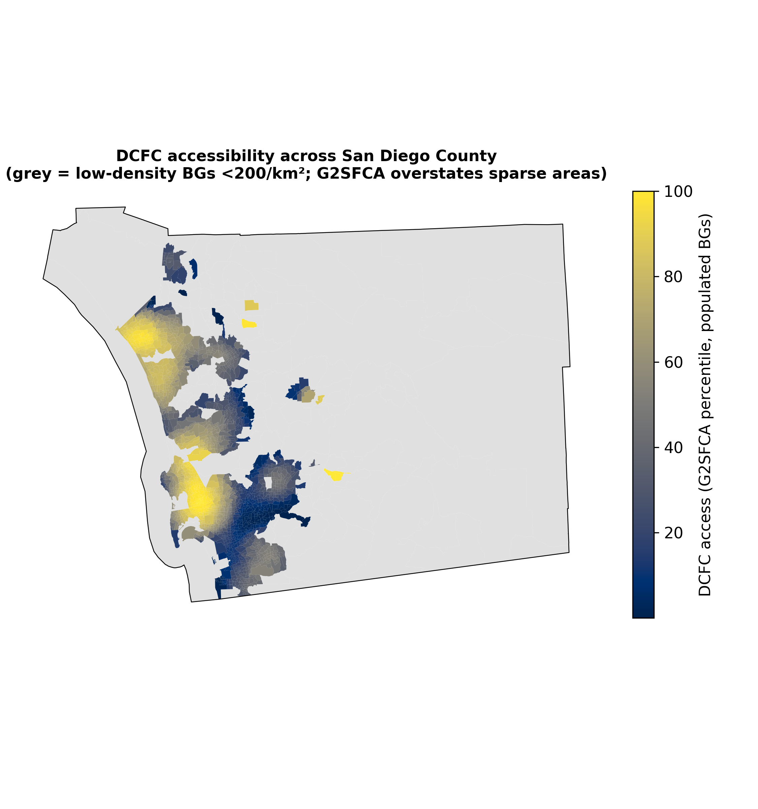
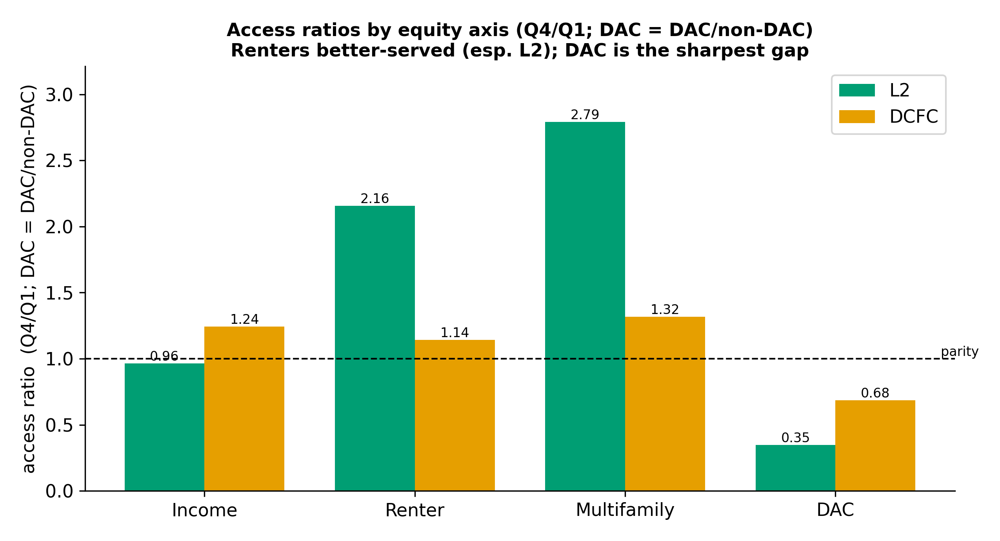
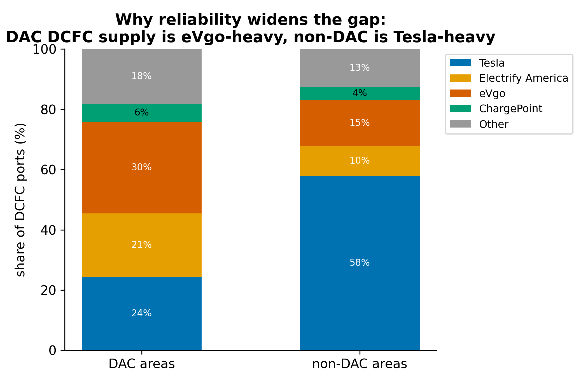
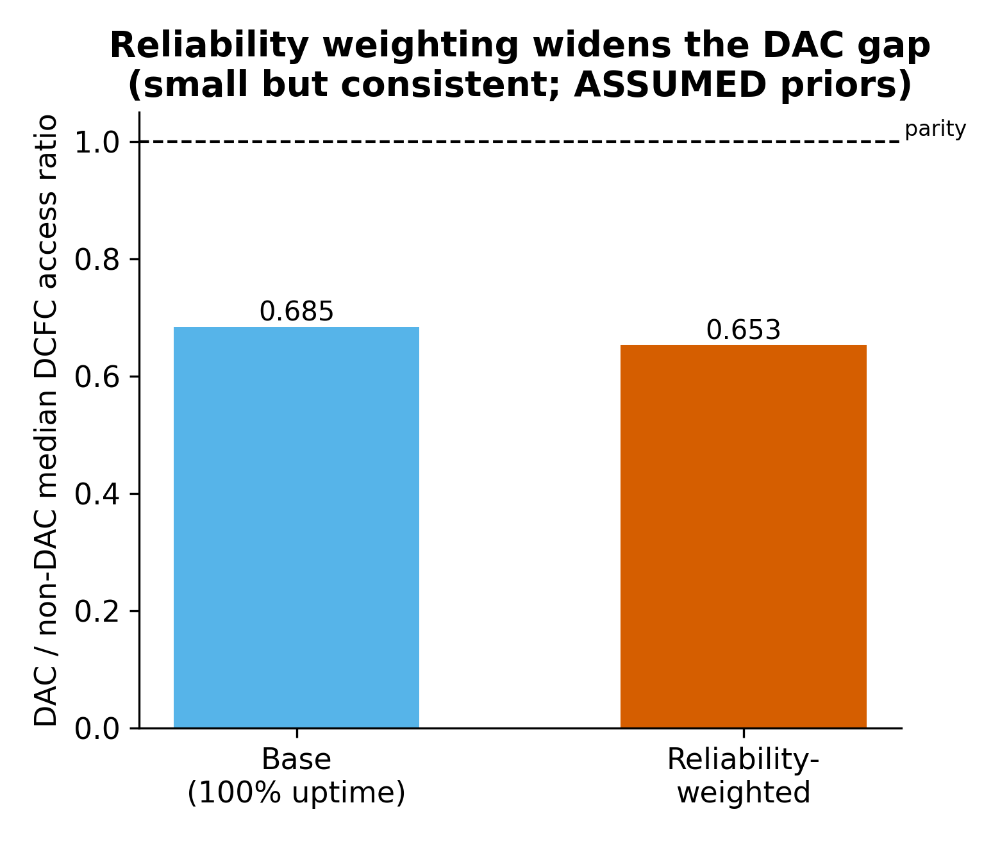
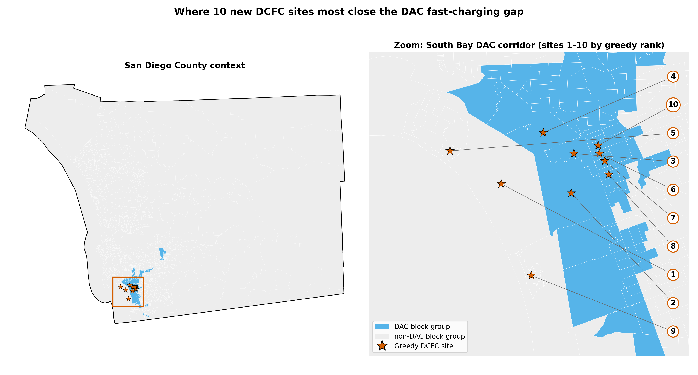

# Results

## Distance baselines and the accessibility reversal

By straight-line distance, disadvantaged communities were closer to fast charging than the rest
of the county. The population-weighted median distance to the nearest DC fast charger was 0.736
miles in disadvantaged-community block groups and 1.11 miles elsewhere. Proximity alone would
suggest disadvantaged communities were better served.

The accessibility metric reversed that picture. Once the population competing for each charger was
counted, the population-weighted median fast-charging access score was lower in disadvantaged
communities than elsewhere, 0.000233 versus 0.000341 (both rounded to three significant figures, with the ratio below computed from the unrounded medians). The ratio of disadvantaged to non-disadvantaged access was 0.6845 at the primary specification, about 32 percent worse served, and roughly 2 to 34 percent worse across the range of specifications reported below (Figure 1). The direction of the reversal was stable across single changes of assumption, but its size was not, and we report both. The reversal held across the catchment-radius check, with ratios of 0.6575, 0.6845, and 0.9752 at 4, 6, and 10 miles, never crossing parity, so the gap was widest at the shorter radii and narrowed to about 2 percent at 10 miles. It held when crosswalked disadvantaged-community values were excluded, at a ratio of 0.700. It held under a demand reweight that scaled effective demand toward higher-income block groups as a proxy for electric-vehicle ownership: the ratio rose from 0.6845 at residential population to 0.818 when demand scaled linearly with income, about 18 percent worse, and stayed below parity at every weighting up to a quadratic one (0.941). We weight demand by residential population rather than current electric-vehicle ownership for a specific reason. Population weighting answers a latent-demand question, who would be underserved if every household here owned an electric vehicle, which is the relevant question for an equity study about residents who lack private charging today. Weighting by current registrations instead answers a realized-demand question, and current adoption is itself shaped by the access gap this study measures, so registration weighting partly builds the outcome into the demand term. We therefore treat population as the primary measure and report the 0.818 linear and 0.941 quadratic income weightings as sensitivities. The reading we take is that disadvantaged communities were worse served for fast charging by roughly 2 to 34 percent depending on the catchment radius and demand measure, and that the direction did not depend on either choice taken alone.

One combination did cross parity. Imposing the 10-mile catchment and the linear income reweight together gave a ratio of 1.19, the only specification tested in which disadvantaged communities were not worse served. The 6-mile catchment is the primary specification, supported by the observed distance distribution in the county, where the median block group is within roughly one mile of a fast charger, and linear income weighting is an aggressive proxy for electric-vehicle ownership rather than a measurement of it. Stacking the conservative radius tail with the aggressive demand tail is therefore the least likely of the configurations tested. We report it because the deficit is not invariant to that joint extreme, and a reader should weigh the result against it.

The supply base behind this gap is thin, which we state plainly. Disadvantaged-community fast charging rests on 33 DCFC ports against 1,312 elsewhere. To bound the uncertainty this introduces, we resampled the result two ways at the primary specification. A spatial block bootstrap that resampled whole census tracts placed the access ratio between 0.599 and 0.808, with no resample of 2,000 reaching parity. A station-level bootstrap that resampled the DCFC stations placed it between 0.412 and 1.024, wider because of the small port count, with about 3.4 percent of resamples reaching parity. Under both schemes the gap pointed the same direction in at least 96 percent of resamples. The magnitude of the fast-charging deficit is uncertain, but at the primary specification its sign is not. Because straight-line distance can cross San Diego Bay, we also tested whether the bayfront geography inflates the gap. Excluding the 14 block groups whose nearest fast charger is reached only by a straight-line path across bay water moved the ratio from 0.6845 to 0.6842, so the deficit is not an artifact of measuring distance across water.

{#fig:f1 width=85%}

The spatial pattern of fast-charging access is shown in Figure 2. Access concentrated in the urban
core and the South Bay. Low-density rural block groups, where the accessibility method overstates
access, are shown separately and were excluded from the siting analysis.

{#fig:f2 width=85%}

## Equity contrasts across housing and environmental-justice axes

Access was contrasted across four axes (Figure 3). For income, renter share, and multifamily
share, the contrast is the ratio of the top quartile to the bottom quartile. For
disadvantaged-community status, it is the ratio of disadvantaged to non-disadvantaged areas. For income, renter share, and multifamily share, a value above one
means the top quartile is better served. For disadvantaged-community status the ratio is
disadvantaged to non-disadvantaged, so a value below one means disadvantaged communities are
worse served.

Renter-heavy and multifamily-heavy areas were better served, not worse. The renter ratio was 2.2250
for Level 2 and 1.2646 for fast charging. The multifamily ratio was 2.9771 for Level 2 and 1.4268 for
fast charging. The surplus was largest for Level 2 charging in both cases, which is the workplace
and commercial charging concentrated in dense areas, and much smaller for fast charging. Income
showed only a weak gradient, with a fast-charging ratio of 1.2517 and a Level 2 ratio of 0.9319.

Disadvantaged-community status was the sharpest axis. Disadvantaged communities had a fast-charging access ratio of 0.6845, well under one. Their Level 2 ratio fell below one only at the shorter Level 2 catchment, and at the matched 6-mile radius it rose above one, so the deficit that holds across specifications is the fast-charging one. The equity deficit in this county therefore tracked environmental-justice burden, not housing tenure. It was not an artifact of where the disadvantaged-community threshold was set. Recomputed at the 70th and 80th percentiles of the screening score, the fast-charging ratio was 0.76 and 0.73, against 0.68 at the 75th-percentile primary cutoff, and stayed below parity at every cut. The gap also held inside both tenure halves. Splitting block groups at the median renter share, disadvantaged renter-heavy and disadvantaged owner-heavy groups each had lower median fast-charging access than either non-disadvantaged group, so disadvantaged-community status dominated renter share rather than the reverse.

{#fig:f3 width=85%}

These four axes are correlated, so we tested whether the disadvantaged-community gap was a restatement of income with a single model. A linear regression of fast-charging access on disadvantaged-community status, income, renter share, and multifamily share, with the continuous predictors and the outcome standardized and disadvantaged-community status entered as a 0/1 indicator, gave disadvantaged-community status the largest and most negative coefficient, -0.47 with a standard error of 0.09, and the largest partial R-squared, 0.0130. Income carried a small positive coefficient of 0.09. The model explained little variance overall, with an R-squared of 0.035 across 2,048 block groups, so we read it as a ranking of weak predictors rather than a strong fit, in which disadvantaged-community status is distinguishable from zero even as the full model leaves most variation unexplained. The regression is fit on complete cases across all four predictors, ten block groups fewer than the county total of 2,058, because ten are missing at least one predictor input. One lacks disadvantaged-community status, eight lack income, and seven lack renter or multifamily share, overlapping to ten unique block groups. Within that ranking disadvantaged-community status was not absorbed by income, which matches the ratio contrasts. The association is not separable from spatial structure. When access was modeled with a spatial error term that absorbs geographically structured variation, the disadvantaged-community coefficient attenuated and lost significance, because disadvantaged communities and low-access areas cluster in the same part of the county. For this reason the equity claim is descriptive, that people in disadvantaged communities receive worse service, and rests on the population-weighted effect sizes rather than on regression inference that holds location constant. We treated the robustness checks as attempts to make the gap disappear, and report them in the order we ran them. It was not a restatement of income, since disadvantaged-community status kept the largest negative coefficient with income held in the same model. It was not an artifact of where the disadvantaged-community threshold was set, since it held at the 70th and 80th percentiles as well as the 75th. It was not produced by the catchment radius, since it held from 4 to 10 miles. It was not an artifact of measuring distance across water, since excluding the bayfront block groups left it unchanged (Section 3.1). And it reproduced on a random split of the county's census tracts into two halves, with ratios of 0.641 and 0.616, though this internal check is coarse because each half holds only a handful of fast-charging ports. Each attempt to explain the gap away failed.

## Reliability-weighted access

The supply disadvantaged communities depend on is drawn from different and lower-reliability networks than the rest of the county, a measured composition disparity. Discounting supply by assumed network reliability widens the fast-charging gap as a consequence, but that discount rests on assumed priors, so we report the composition disparity as the finding and the discount as an illustrative sensitivity rather than a central result.

The fast-charging ports located in disadvantaged communities came from a different network mix than
elsewhere (Figure 4). Among DCFC ports in disadvantaged-community block groups, 24 percent were
Tesla and 30 percent were EVgo. Among non-disadvantaged ports, 58 percent were Tesla and 15
percent were EVgo. Because Tesla carried the highest assumed reliability prior and EVgo a lower
one, the ports-weighted mean assumed reliability was 0.815 in disadvantaged communities and 0.875
elsewhere. The disadvantaged-community fast-charging mechanism rests on a small base of 33 DCFC
ports, against 1,312 elsewhere.

{#fig:f4 width=80%}

Weighting each station's supply by its network's expected reliability widened the gap rather than narrowing it. The measured driver is composition. Disadvantaged communities draw more of their fast-charging supply from lower-reliability networks (Figure 4). The disadvantaged-to-non-disadvantaged ratio moved from 0.6845 unweighted to 0.6533
weighted (Figure 5). The result behaved as the composition mechanism predicts under every perturbation tested. Uniform reliability applied to all chargers reproduced the unweighted ratio of 0.6845 exactly, at every uptime level from 60 to 100 percent, because uniform scaling cancels in a ratio, so the effect depends only on differences between networks. Compressing the assumed spread between networks gave 0.667 and widening it gave 0.649, both still widened relative to the unweighted baseline. The decisive test is inverting the ranking. When the network reliability values were inverted so that the network disadvantaged communities rely on most, EVgo, received the highest reliability and Tesla the lowest, the gap narrowed to 0.711, crossing above the unweighted 0.6845 but not reaching parity. This is the signature of the composition mechanism. Making the disadvantaged-community network the most reliable improves their relative access, confirming that network composition drives the effect, while the underlying supply disparity is deep enough that even a maximally favorable reliability assumption leaves disadvantaged communities worse served.

{#fig:f5 width=70%}

## Greedy DCFC siting

The siting analysis optimizes the reliability-weighted fast-charging score, so its gap closures are reported against the reliability-weighted disadvantaged-community access gap, not against the unweighted headline gap of 0.6845. On the reliability-weighted surface the population-weighted mean disadvantaged-to-non-disadvantaged ratio was 0.6420 and the median was 0.6533, and each closure below is computed against the matching aggregate, the mean closures against 0.6420 and the median closures against 0.6533. We state this because the optimization targets the reliability-weighted surface, and the closure percentages should be read against the metric it actually maximizes.

A greedy procedure selected ten block-group locations for added DC fast charging, maximizing the
population-weighted mean reliability-weighted DCFC access of disadvantaged-community block groups
(Figure 6). All ten selected centroids lie in the South Bay corridor of southern San Diego County.
By incorporated place, reverse-geocoded against the U.S. Census geocoder, they fall in National
City (6 sites), Coronado (3), and the City of San Diego (1). Seven of the ten chosen block groups
are themselves disadvantaged communities. The three Coronado sites are non-disadvantaged bayfront
block-group centroids.

Excluding the three non-buildable Coronado bayfront centroids, the seven in-corridor sites raised the disadvantaged-community population-weighted mean access from 0.000236 to 0.000279, a gain of 18.6 percent, and the median from 0.000196 to 0.000247, a gain of 26.0 percent. This closed 31.0
percent of the disadvantaged-to-non-disadvantaged gap on the mean and 48.4 percent on the median.
These are the headline figures for the in-corridor candidate sites.

Including the three Coronado centroids, the full set of ten raised the disadvantaged-community mean to 0.000299, a gain of 27.0 percent, and the median to 0.000271, a gain of 38.5 percent, closing
45.0 percent of the gap on the mean and 71.5 percent on the median. These ten-site figures are an
upper bound, because the three Coronado centroids are non-buildable artifacts of using block-group
centroids and Euclidean distance, and because the additive model captures competition between new
and existing chargers but not among the newly selected sites. In both cases the modeled gains
accrued almost entirely to disadvantaged communities, with non-disadvantaged mean access rising
only 1.5 percent.

{#fig:f6 width=95%}
